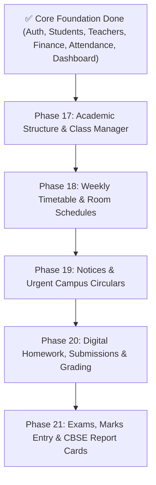

# SchoolHub — Phase-by-Phase Feature Implementation Roadmap

> **Target:** Complete, production-grade Multi-Tenant School Management SaaS for Indian K-12 Schools (CBSE / ICSE / State Boards).
> **Date:** October 2026 (Updated post-backend-connection)

---

## 📊 1. Current State vs. Missing Features Audit

| Module | Backend API | Frontend View | Interactive Mutations & Live Hooks | Status |
| :--- | :---: | :---: | :---: | :---: |
| **Authentication & Multi-Tenancy** | ✅ 100% | ✅ 100% | ✅ Live `/auth/login`, `/register-school`, `/auth/me` | **Production Ready** |
| **SaaS Landing & Self-Service** | ✅ 100% | ✅ 100% | ✅ Confetti modal, pricing cards, school provisioning | **Production Ready** |
| **Role-Aware Dashboards (Indian Context)**| ✅ 100% | ✅ 100% | ✅ Live KPI queries (`/dashboard`), role views | **Production Ready** |
| **Dual-Mode Theme & Design Tokens** | N/A | ✅ 100% | ✅ Clean CSS variables, light/dark contrast | **Production Ready** |
| **Students & Admissions** | ✅ 100% | ✅ 100% | ✅ Live list (`/students`), admission modal (`POST /students`) | **Production Ready** |
| **Faculty & Teachers Management** | ✅ 100% | ✅ 100% | ✅ Live list (`/teachers`), Add Faculty modal (`POST /teachers`) | **Production Ready** |
| **School Finance & ₹ Fee Collection** | ✅ 100% | ✅ 100% | ✅ Live KPIs, invoice list, collect modal, fee builder | **Production Ready** |
| **Class Attendance & Daily Roll Call** | ✅ 100% | ✅ 100% | ✅ Live sheet (`/attendance`), mark all present, batch submit | **Production Ready** |
| **Frontend Enterprise Architecture** | N/A | ✅ 100% | ✅ Layered types, services, TanStack hooks, sliced components | **Production Ready** |
| **Academics (Classes, Sections, Subjects)**| ✅ 100% | ✅ 100% | ✅ Live class & subject queries, modular catalog & milestones | **Production Ready** |
| **Notice Board & Urgent Circulars** | ✅ 100% | ✅ 100% | ✅ Live queries (`/announcements`), PDF attachments, publish modal | **Production Ready** |
| **Weekly Timetables & Schedules** | ✅ 100% | ⚠️ Mock data | ❌ Fetch timetable, add period schedule | **Up Next (Phase 19)** |
| **Homework & Assignments** | ✅ 100% | ⚠️ Checklist only | ❌ Teacher publisher, student submit, grading | **Queued (Phase 20)** |
| **Examinations & CBSE Report Cards** | ✅ 100% | ⚠️ Static scores | ❌ Exam date sheet, marks entry grid, report card | **Queued (Phase 21)** |

---

## 🚀 2. Phase-by-Phase Implementation Execution Plan

---

### 📌 Phase 13: Daily Class Attendance & Roll Call Engine (Immediate)
- **Goal:** Enable teachers to mark daily attendance in under 30 seconds with 1-click workflows.
- **Key Deliverables:**
  1. **Dual-View Attendance Screen:** Toggle between **"Daily Roll Call Sheet"** and **"Monthly Dot Matrix Grid"**.
  2. **1-Click "Mark All Present" Action:** Default all active students to Present, allowing quick exceptions for absentees.
  3. **Pills for Every Student:** `P` (Present in Mint), `A` (Absent in Rose), `L` (Late in Yellow), `HD` (Half-Day in Sky).
  4. **Absence Reason Drawer:** Capture medical notes, uninformed absence, or parental leave applications.
  5. **Live Backend Integration:** Fetch roster via `GET /api/v1/attendance` and save atomically via `POST /api/v1/attendance`.
  6. **Quick Roll Call Modal:** Directly accessible from the Teacher Dashboard's Hero button.

---

### 📌 Phase 14: Academic Structure & Class Management
- **Goal:** Dynamic management of Classes, Sections, Subjects, and Academic Years.
- **Key Deliverables:**
  1. Connect class list to `GET /api/v1/academics/classes`.
  2. Modal to create new Classes and Sections (`POST /api/v1/academics/classes`).
  3. Course catalog and subject allocation to teachers (`POST /api/v1/academics/classes/assign-subject`).

---

### 📌 Phase 15: Student Admissions & Rich Profile Drawer
- **Goal:** Full student lifecycle management from admission to alumni transfer.
- **Key Deliverables:**
  1. Multi-step Student Admission Form submitting to `POST /api/v1/students` (Personal details, Aadhaar/APAAR ID, Parent info, Class, Section, Roll No, Bus Route).
  2. Live student search & filters (by Class, Section, House, Gender, Fee status).
  3. Student Profile Drawer showing 75% CBSE attendance meter, fee dues in ₹, and academic marks.

---

### 📌 Phase 16: Faculty Management & Subject Allotment
- **Goal:** Teacher profiles, staff directory, and teaching workloads.
- **Key Deliverables:**
  1. Add Faculty modal submitting to `POST /api/v1/teachers`.
  2. Teacher profile card displaying assigned classes, subjects, and weekly lecture hours.

---

### 📌 Phase 17: School Finance, UPI Fees & Receipts (in ₹ INR)
- **Goal:** Complete fee lifecycle with Indian payment methods and printable receipts.
- **Key Deliverables:**
  1. Itemized Fee Structure Builder (Tuition, Annual, Lab, Transport).
  2. Bulk Invoice Generator for class sections (`POST /api/v1/finance/invoices/generate`).
  3. Collect Payment Modal with UPI QR simulation & instant **Printable Fee Receipt** with school header.

---

### 📌 Phase 18: Digital Homework, Submissions & Grading
- **Goal:** Digital student almanac replacing paper diaries.
- **Key Deliverables:**
  1. Teacher Homework Publisher (`POST /api/v1/assignments`).
  2. Student Submission Portal (`POST /api/v1/assignments/:id/submit`).
  3. Teacher Grading & Feedback Queue (`POST /api/v1/assignments/submissions/:id/grade`).

---

### 📌 Phase 19: Examinations, Marks Entry & CBSE Report Cards
- **Goal:** Evaluation framework matching CBSE/ICSE standards.
- **Key Deliverables:**
  1. Exam Term Creator (PA-1, Half Yearly, PA-2, Annual/Pre-Board).
  2. Subject Teacher Marks Entry Grid (Max Marks, Obtained, Auto Grade calculation).
  3. Student Report Card with term-wise comparison, scholastic/co-scholastic grades, and Principal signature block.

---

### 📌 Phase 20: Circulars, Almanac & Unread Bell Notifications
- **Goal:** Institutional broadcasting and alert management.
- **Key Deliverables:**
  1. Publish Notice modal with audience targeting (`POST /api/v1/announcements`).
  2. Zustand-driven notification bell with interactive dropdown.
